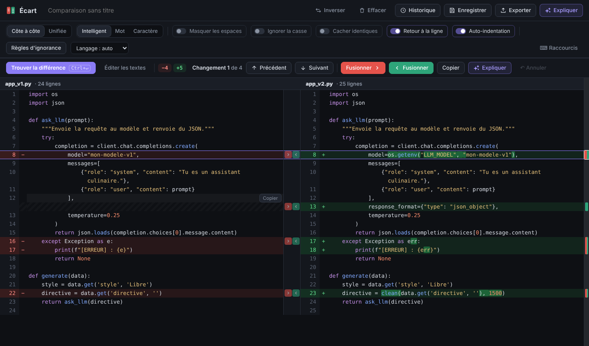
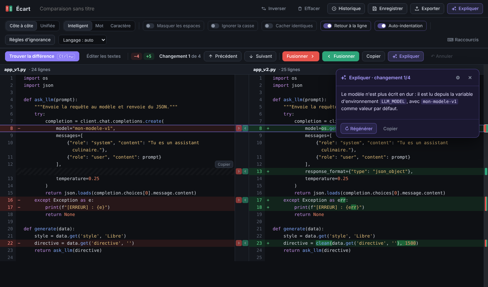

<h1 align="center">Code-diff</h1>

<p align="center">
  <b>Compare deux versions de code ou de texte, corrige et fusionne directement dans le diff.</b><br>
  Thème sombre · une seule page HTML · aucune installation · aucun compte
</p>

<p align="center">
  
  
  
  
  
</p>

<p align="center">
  <a href="https://funappi.github.io/Code-diff/"><b>Ouvrir l'application</b></a>
</p>

<p align="center">
  
</p>

## Sommaire

- [Fonctionnalités](#fonctionnalités)
- [Langages pris en charge](#langages-pris-en-charge)
- [Démarrage rapide](#démarrage-rapide)
- [Utilisation](#utilisation)
- [Raccourcis clavier](#raccourcis-clavier)
- [Explications par IA](#explications-par-ia)
  - [Services en ligne](#services-en-ligne)
  - [Modèles locaux avec Ollama et LM Studio](#modèles-locaux-avec-ollama-et-lm-studio)
- [Confidentialité](#confidentialité)
- [Publier sur GitHub Pages](#publier-sur-github-pages)
- [Licence](#licence)

## Fonctionnalités

**Comparer**
- Vue **côte à côte** ou **unifiée**, avec défilement commun et mini-carte des changements
- Précision réglable : **intelligent**, **mot** ou **caractère**
- Masquer les espaces, ignorer la casse, replier les blocs identiques
- **Règles d'ignorance** (texte ou regex) : horodatages, UUID, hash, numéros de build…
- Recalcul en direct pendant que tu tapes

**Corriger et fusionner**
- Un clic sur une ligne la rend **modifiable directement dans le diff** (Entrée, Échap, Tab, ↑/↓)
- **Fusion** de chaque changement vers la gauche ou la droite, avec passage automatique au changement suivant
- **Auto-indentation** : le code collé ou fusionné est ré-indenté (désactivable)
- Annulation avec `Ctrl+Z`

**Le reste**
- **Coloration syntaxique** pour une vingtaine de langages
- **Expliquer** () : explication d'un changement ou résumé du diff par le LLM de ton choix
- Glisser-déposer de fichiers, historique et enregistrement dans le navigateur
- Export du patch (`.diff`) ou d'un rapport HTML imprimable en PDF

<p align="right"><a href="#sommaire">↑ Retour au sommaire</a></p>

## Langages pris en charge

La coloration syntaxique et l'auto-indentation s'adaptent au langage, détecté automatiquement (extension du fichier ou contenu) ou choisi à la main.

<p>
  
  
  
  
  
  
  
  
  
  
  
  
  
  
  
  
  
  
  
  
  
</p>

| Auto-indentation au collage et à la fusion | Langages |
|---|---|
| Recalcul complet d'après l'imbrication (`{ }`, `( )`, `[ ]`, `case`…) | JavaScript, TypeScript, Java, C#, C/C++, Go, Rust, PHP, Swift, Kotlin, JSON, CSS |
| Nettoyage (tabulations → espaces, retrait commun retiré) | Python, YAML, Ruby |
| Aucune modification | Texte brut, logs, CSV, Markdown, SQL, Shell, TOML, HTML/XML |

> L'indentation de Python est une partie du sens du code : elle n'est pas recalculée, seulement nettoyée.

<p align="right"><a href="#sommaire">↑ Retour au sommaire</a></p>

## Démarrage rapide

**En ligne** : ouvre [funappi.github.io/Code-diff](https://funappi.github.io/Code-diff/).

**En local** : télécharge [`index.html`](index.html) et ouvre-le dans ton navigateur (double-clic). Aucun serveur, aucun `npm install`.

```bash
git clone https://github.com/funappi/Code-diff.git
cd Code-diff
# puis ouvre index.html dans ton navigateur
```

<p align="right"><a href="#sommaire">↑ Retour au sommaire</a></p>

## Utilisation

1. Colle le texte original à gauche et la version modifiée à droite, ou glisse deux fichiers dessus.
2. Clique sur **Trouver la différence**. Le diff passe en plein écran.
3. Navigue avec **Précédent / Suivant**, puis **Fusionne** d'un côté ou de l'autre : tu arrives automatiquement sur le changement suivant.
4. Clique sur une ligne pour la corriger sur place. Le diff se met à jour pendant que tu tapes.
5. **Éditer les textes** (ou `Alt+E`) rouvre les deux zones de saisie pour recoller du code.

<p align="right"><a href="#sommaire">↑ Retour au sommaire</a></p>

## Raccourcis clavier

| Action | Raccourci |
|---|---|
| Trouver la différence | `Ctrl` + `Entrée` |
| Changement suivant / précédent | `Alt` + `↓` / `↑` (ou `J` / `K`) |
| Fusionner vers la droite / la gauche | `Alt` + `→` / `←` |
| Afficher / masquer les textes | `Alt` + `E` |
| Annuler la dernière modification | `Ctrl` + `Z` |
| Nouvelle ligne indentée (en édition) | `Entrée` |
| Abandonner la ligne en cours | `Échap` |
| Ligne précédente / suivante (en édition) | `↑` / `↓` |
| Indenter / désindenter (en édition) | `Tab` / `Maj` + `Tab` |

<p align="right"><a href="#sommaire">↑ Retour au sommaire</a></p>

## Explications par IA

Le bouton **Expliquer** décrit en langage clair le changement sélectionné, ou résume tout le diff. Au premier clic, une fenêtre te demande de choisir ton LLM. Tu peux la rouvrir avec le ⚙ du panneau d'explication.

<p align="center">
  
</p>

### Services en ligne

Colle ta clé API : la page appelle directement le service, sans serveur intermédiaire.

<p>
  
  
  
  
  
  
</p>

Tout service **compatible OpenAI** fonctionne aussi : choisis « Autre » et renseigne l'URL de base et le modèle. Le bouton *détecter les modèles disponibles* remplit la liste des modèles.

### Modèles locaux avec Ollama et LM Studio

Tes textes ne quittent pas ton ordinateur.

<p>
  
  
</p>

| Outil | À faire une fois | URL par défaut |
|---|---|---|
| **Ollama** | Lance-le avec la variable d'environnement `OLLAMA_ORIGINS=https://funappi.github.io`, puis redémarre-le | `http://localhost:11434/v1` |
| **LM Studio** | Onglet *Developer* : démarre le serveur local et active **Enable CORS**, puis charge un modèle | `http://localhost:1234/v1` |

Ensuite, dans les réglages de l'IA, choisis Ollama ou LM Studio, clique sur *détecter les modèles disponibles* et **Tester**.

> Depuis une page en https, Chrome peut demander l'autorisation d'accéder au réseau local : accepte. Safari peut bloquer ces appels. Si tu ouvres `index.html` en local, mets `OLLAMA_ORIGINS=*`.

<p align="right"><a href="#sommaire">↑ Retour au sommaire</a></p>

## Confidentialité

- Tout se passe dans ton navigateur : **tes textes ne sont envoyés nulle part** tant que tu n'utilises pas Expliquer.
- Avec Expliquer, seuls le changement (ou le diff) et ses lignes voisines sont envoyés, **uniquement** au service que tu as choisi.
- Ta clé API est enregistrée dans le `localStorage` de ton navigateur, **en clair**. Ne l'utilise pas sur un ordinateur partagé. Le bouton *Oublier* des réglages l'efface.
- Les comparaisons enregistrées et la dernière session restent aussi dans ton navigateur.

<p align="right"><a href="#sommaire">↑ Retour au sommaire</a></p>

## Publier sur GitHub Pages

1. Dépôt → **Settings** → **Pages**
2. *Source* : **Deploy from a branch**, branche `main`, dossier `/ (root)`
3. Après une minute, le site est en ligne sur `https://<utilisateur>.github.io/<dépôt>/`

Pense à adapter l'adresse dans `OLLAMA_ORIGINS` si tu héberges ta propre copie.

<p align="right"><a href="#sommaire">↑ Retour au sommaire</a></p>

## Licence

[MIT](LICENSE) © 2026 funappi
